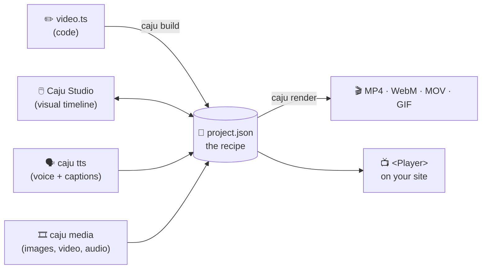
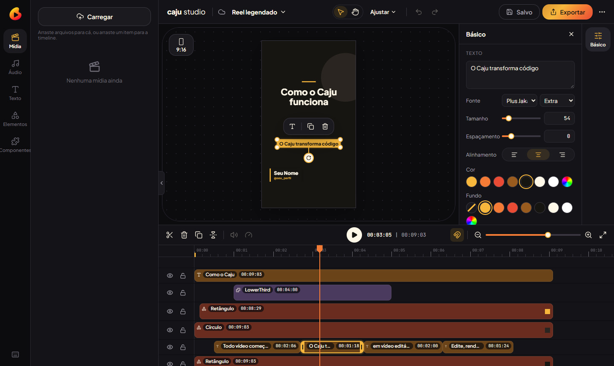
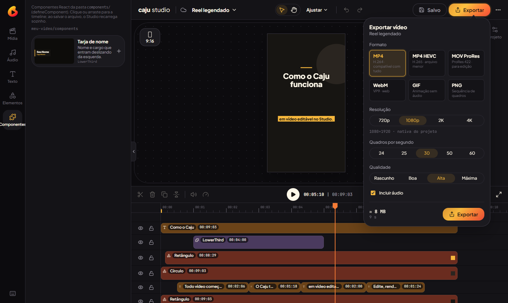
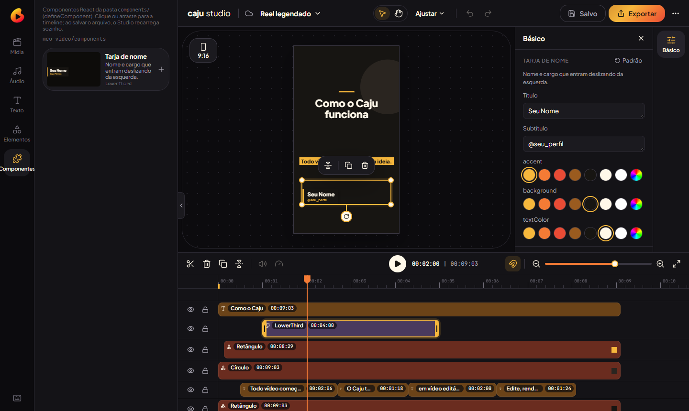

<p align="center"></p>

<p align="center"><strong>Code it. Then move it.</strong><br>
Motion graphics made with code <em>and</em> a visual timeline, on the same file.</p>

<p align="center">
  <a href="LICENSE"></a>
  
  
  <a href="https://mardelaraujo.github.io/caju_motion/"></a>
</p>

<p align="center"><b>English</b> · <a href="README.pt-BR.md">Português</a></p>

<p align="center"></p>

---

## Contents

1. [What Caju Motion is](#1-what-caju-motion-is)
2. [Status: what works and what is missing](#2-status-what-works-and-what-is-missing)
3. [What you need](#3-what-you-need)
4. [Installation](#4-installation)
5. [Your first video, step by step](#5-your-first-video-step-by-step)
6. [How Caju thinks: the basics](#6-how-caju-thinks-the-basics)
7. [Three ways to create](#7-three-ways-to-create)
8. [Voice-over and captions](#8-voice-over-and-captions)
9. [Setting up your API keys](#9-setting-up-your-api-keys)
10. [Media: videos, images and audio](#10-media-videos-images-and-audio)
11. [Exporting](#11-exporting)
12. [Putting a video on a website (Player)](#12-putting-a-video-on-a-website-player)
13. [Using it with AI agents](#13-using-it-with-ai-agents)
14. [All commands](#14-all-commands)
15. [Troubleshooting](#15-troubleshooting)
16. [What was left out (and how to manage without it)](#16-what-was-left-out-and-how-to-manage-without-it)
17. [Contributing](#17-contributing)

---

## 1. What Caju Motion is

Caju Motion is a **free, open-source (MIT)** tool for making animated videos: reels, explainers, data videos, podcast audiograms, auto-captioned clips and more.

Every Caju video is described by **one file**, `project.json`. Think of it as a **recipe**: what shows on screen, when, how it moves and what sound plays. You can write that recipe in two ways, and they work together:

| | With code (`video.ts`) | By hand (Caju Studio) |
|---|---|---|
| For | developers, or anyone using an AI agent | everyone |
| Good at | many similar videos, data-driven videos, long scripts | fine-tuning, positioning, colors, trimming |
| How | TypeScript with `defineProject` + `caju build` | a browser editor, similar to CapCut |

> The key idea: generate a video with code, adjust it in the Studio, change the code and rebuild, **without losing the hand-made adjustments**.

The **renderer** then draws every frame (30 per second) in a hidden browser and joins them, with the audio, into a video file (MP4, WebM, MOV, GIF…). The Studio preview and the final video run the same code, so what you see is what you get.



---

## 2. Status: what works and what is missing

**Version 0.2 (not on npm yet).** Everything below works and is tested automatically on Windows and Linux on every change.

| Feature | Status | Command / where |
|---|---|---|
| Visual editor (Caju Studio) | ✅ ready | `caju studio` |
| Video by code | ✅ ready | `video.ts` + `caju build` |
| Animated React components (charts, counters, lower thirds) | ✅ ready | `components/` folder |
| Export MP4, MP4 HEVC, MOV ProRes, WebM, GIF, PNG | ✅ ready | `caju render` or the **Exportar** button |
| Generated voice-over (TTS, free and local with VoiceStudio) + automatic captions | ✅ ready | `caju tts`, `caju voices`, `caju captions` |
| Captions from recorded speech (transcription) | ✅ ready | `caju transcribe` |
| Media probing, thumbnails, waveforms, editing proxies | ✅ ready | `caju media` |
| Player to embed a video in a React site | ✅ ready | `@caju-motion/player` |
| Environment check | ✅ ready | `caju doctor` |
| 5 starter templates | ✅ ready | `create-caju` |
| Skills for AI agents (Claude Code and others) | ✅ ready | `caju skills add` |
| Install with `npm create caju` | ⏳ **pending**: not published to npm yet | for now, [from source](#41-today-from-source) |
| Cloud rendering (`@caju-motion/cloud`) | ⏸️ **postponed** | [workarounds](#16-what-was-left-out-and-how-to-manage-without-it) |
| Template marketplace | ⏸️ **postponed** | [workarounds](#16-what-was-left-out-and-how-to-manage-without-it) |
| Custom fonts as project assets | ⏸️ not yet | use the bundled fonts ([details](#fonts)) |
| Editing keyframes on the timeline | ⏸️ not yet | keyframes play back, but are written in code |

> The Studio's interface and the CLI messages are in Portuguese for now.

---

## 3. What you need

| Item | Required? | Notes |
|---|---|---|
| **Node.js 20.11 or newer** (recommended: 22 LTS) | yes | https://nodejs.org |
| **Google Chrome** or **Microsoft Edge** | yes, to export | rendering uses the browser you already have |
| **Git** | yes, until the npm release | to download the code |
| FFmpeg | **no** | bundled (`ffmpeg-static`) |
| Memory | 4 GB free recommended | with little memory, use `--concurrency 1` |
| Disk | ~1 GB free | long renders need more |
| [VoiceStudio](https://github.com/debpalash/VoiceStudio) | **no** | free local voice for `caju tts` and `caju transcribe` (the default provider), installed separately ([section 8](#8-voice-over-and-captions)); a GPU helps |
| OpenAI or ElevenLabs key | **no** | only for paid cloud voices; VoiceStudio and the placeholder voice are free |

---

## 4. Installation

### 4.1 Today: from source

Open a terminal (PowerShell on Windows, Terminal on macOS/Linux):

```bash
# 1. download
git clone https://github.com/MardelAraujo/caju_motion.git
cd caju_motion

# 2. install dependencies (once; takes 1–3 minutes)
npm install

# 3. build the packages and the Studio (once, and again after a "git pull")
npm run build

# 4. check that everything is in place
npm run caju -- doctor
```

`doctor` should end with **✓ tudo pronto** ("all set"). Example output; versions and numbers vary per machine:

```text
caju doctor — diagnóstico do ambiente

✓ Node.js              v24.13.0
✓ npm                  11.6.2
✓ FFmpeg (render)      6.1.1 (ffmpeg-static)
✓ Navegador (render)   Google Chrome (C:\Program Files\Google\Chrome\Application\chrome.exe)
✓ Caju Studio          app buildado
✓ Projetos             projects: exemplo, exemplo-codigo
✓ Componentes          components: CountUp, LowerThird
✓ Espaço em disco      4.6 GB livres
✓ Memória              6.2 de 15.7 GB livres
✓ Permissão de escrita projects
✓ VoiceStudio (voz)    http://127.0.0.1:3900 · engines: omnivoice, cosyvoice, kittentts · 1 perfil(is) de voz (Narradora)
✓ Voz (caju tts)       voicestudio (padrão) e placeholder; sem chaves de vozes pagas
                       → opcional: para usar openai/elevenlabs, ponha OPENAI_API_KEY ou ELEVENLABS_API_KEY no .env do projeto

✓ tudo pronto
```

If you see **✗** or **!**, the next line (→) tells you what to do. See also [Troubleshooting](#15-troubleshooting).

> **Important:** inside the source checkout, every command starts with `npm run caju --` (with both dashes).
> Example: `npm run caju -- render my-video`. This README writes them as `caju …` to keep them short.

**Keep your videos in another folder.** Projects live in `caju_motion/projects/` by default. Add `--dir` to use another folder:

```bash
npm run caju -- studio --dir C:/Users/you/Videos/caju
npm run caju -- new my-video --dir C:/Users/you/Videos/caju
```

### 4.2 After the npm release (coming soon)

Once the packages are published, you won't need the source code:

```bash
npm create caju@latest my-video      # asks which template to use
cd my-video
npm run dev                          # opens Caju Studio
```

The new project comes with `package.json`, scripts (`dev`, `build`, `check`, `render`, `doctor`), a `.gitignore` that protects your keys, and instructions for AI agents. Templates:

| Template | Format | What it includes |
|---|---|---|
| `blank` | reel 9:16 | an empty project with `video.ts` |
| `reel-legendado` | reel 9:16 | title, captions per line and an animated name lower third |
| `explainer-16x9` | 16:9 | a scene-based explainer with an animated counter |
| `data-video` | feed 4:5 | an animated bar chart from a JSON file |
| `audiograma` | square 1:1 | a podcast cover with an animated waveform |

---

## 5. Your first video, step by step

### Step 1: create the project

```bash
caju new my-video --format reel-9x16
```

Available formats:

| Format | Size | Typical use |
|---|---|---|
| `reel-9x16` | 1080 × 1920 | Reels, Stories, TikTok, Shorts |
| `feed-4x5` | 1080 × 1350 | Instagram/LinkedIn feed |
| `square-1x1` | 1080 × 1080 | square posts, podcasts |
| `landscape-16x9` | 1920 × 1080 | YouTube, presentations |

Each format comes with its **safe areas** marked (where the app's UI doesn't cover the video).

### Step 2: open the Studio

```bash
caju studio          # from source: npm run studio
```

Open **http://localhost:3700** in your browser.

<p align="center"></p>

| Area | What it is for |
|---|---|
| **Left** | library: Mídia (upload images/videos/audio), Áudio, Texto, Elementos (shapes) and Componentes |
| **Center** | video preview; click to select, drag to move, use the handles to rotate and resize |
| **Right** | properties of the selected item: text, font, size, colors, background, volume |
| **Bottom** | timeline: each row is a track; drag clips to change when they appear, pull the edges to trim |

Main shortcuts: **Space** play/pause · **S** split at the playhead · **Delete** delete · **Ctrl+D** duplicate · **Ctrl+Z / Ctrl+Shift+Z** undo/redo · **←/→** one frame · **Ctrl+S** save.

The Studio saves to `project.json` itself and keeps every previous version in `projects/<id>/.caju/history/`, so you can always go back.

### Step 3: export

Click **Exportar** at the top right:

<p align="center"></p>

Or from the terminal:

```bash
caju render my-video
```

The file goes to `projects/my-video/renders/`. That's your first video. 🎉

---

## 6. How Caju thinks: the basics

You don't need this to use the Studio, but it helps a lot, especially with code or AI agents.

- **Project:** a folder in `projects/<id>/` with `project.json` and the files it uses (`assets/`).
- **Frame:** time in Caju is counted in whole frames. At 30 fps, 1 second = 30 frames.
- **Track:** one row of the timeline. Tracks at the top are drawn in front.
- **Clip:** an item on a track, with a start and a duration: text, shape, image, video, audio or component.
- **Keyframes:** values that change over time (position, opacity, scale, color…), with easing curves.
- **Asset:** a project file (image, video, audio). It always lives **inside** the project folder.

```text
my-video/                       ← a project created with npm create caju
├── package.json
├── .env                        ← your API keys (git-ignored)
├── components/                 ← animated React components (optional)
└── projects/
    └── my-video/
        ├── video.ts            ← the recipe in code (optional)
        ├── project.json        ← the recipe (generated by code and/or edited in the Studio)
        ├── assets/
        │   ├── images/  video/  data/
        │   └── audio/vo/  audio/music/  audio/sfx/
        ├── renders/            ← exported videos (git-ignored)
        └── .caju/              ← history and cache (git-ignored)
```

---

## 7. Three ways to create

### 7.1 In the Studio (no code)

Drag images and videos into **Mídia**, add **Texto** and **Elementos**, arrange them on the timeline and export. That's the path in [section 5](#5-your-first-video-step-by-step).

### 7.2 With code (`video.ts`)

Create `projects/<id>/video.ts`:

```ts
import { defineProject } from '@caju-motion/sdk';

export default defineProject({ id: 'promo', format: 'reel-9x16' }, (p) => {
  const { width, height } = p.settings;

  p.scene('intro', 'Intro', 0, p.sec(3), (s) => {
    s.rect(width, height, { fill: '#171512' }, { x: width / 2, y: height / 2, locked: true });
    s.text('Hello, Caju!', { size: 110, weight: 800, color: '#F6B73C' }, {
      x: width / 2,
      y: height / 2,
      enter: { at: 0, dur: 18, rise: 60 }, // slides up as it fades in
    });
  });
});
```

Then generate `project.json` and check it:

```bash
caju build promo     # code → project.json
caju check promo     # validate (structure, files, components)
caju studio          # open it and adjust by hand if you like
```

**Code and Studio live together:** clips made by code are marked `code`, clips made in the Studio are marked `editor`. Running `caju build` again only regenerates the code clips and keeps the Studio ones. If you edited a code clip in the Studio, the build **warns and doesn't save**; use `--force` to let the code win.

### 7.3 React components (charts, counters, lower thirds…)

When keyframes aren't enough, write a component in `components/`:

```tsx
import { z } from 'zod';
import { defineComponent } from '@caju-motion/renderer';
import { interpolate, useFrame } from '@caju-motion/core';

export const Counter = defineComponent({
  name: 'Counter',
  label: 'Animated counter',
  schema: z.object({
    to: z.number().default(100),
    color: z.string().describe('color').default('#F6B73C'),
  }),
  component: ({ to, color }) => {
    const value = Math.round(interpolate(useFrame(), [0, 45], [0, to], { extrapolateRight: 'clamp' }));
    return <div style={{ fontSize: 160, fontWeight: 800, color }}>{value}</div>;
  },
});
```

It shows up in the Studio's **Componentes** tab. The `schema` props become controls (text, number, color), and the Studio reloads by itself when you save the file:

<p align="center"></p>

> Golden rule: the animation depends **only on the frame** (`useFrame()`) and the props. No `Math.random()`, `Date.now()`, timers or CSS animations; `caju check` flags them. That's what keeps the preview and the final video identical.

---

## 8. Voice-over and captions

`caju tts` turns text into a voice-over, records **when each word is spoken**, and builds synced captions.

```bash
# real voice, free, on your computer (VoiceStudio open; see below)
caju tts my-video --text "Every video starts with an idea. Caju turns code into video." --language en
caju voices                                                   # engines and voice profiles
caju tts my-video --script script.txt --model omnivoice --voice <profile> --seed 7 --language en

# without VoiceStudio: placeholder voice (free: a soft tone + estimated timings)
caju tts my-video --text "Every video starts with an idea." --provider placeholder

# paid cloud voices (your key, your account)
caju tts my-video --script script.txt --provider openai --voice nova --language en
caju tts my-video --script script.txt --provider elevenlabs --voice <voice_id>
```

What it creates in the project:

| File | Content |
|---|---|
| `assets/audio/vo/locucao.mp3` | the voice-over (`--name` changes the name) |
| `assets/data/locucao.words.json` | the script and the start/end of every word |
| `assets/data/locucao.srt` | the captions, ready for YouTube/Instagram |

And on the timeline: the voice-over on a **Locução** track and one caption per sentence on a **Legendas** track, editable like any text.

| Provider (`--provider`) | Cost | Word timings | Key |
|---|---|---|---|
| `voicestudio` (default) | free (runs on your computer) | exact | none |
| `placeholder` | free | estimated | none |
| `openai` | paid (your account) | exact | `OPENAI_API_KEY` |
| `elevenlabs` | paid (your account) | exact | `ELEVENLABS_API_KEY` |

**VoiceStudio** ([github.com/debpalash/VoiceStudio](https://github.com/debpalash/VoiceStudio)) is a free, open-source alternative to ElevenLabs that runs on your machine: text to speech, voice cloning and voice design. Caju talks to it over HTTP (port 3900); install and open it separately:

- **Windows:** `irm https://voicestudio.sh/install | iex` in PowerShell, or the `.exe` from the project's Releases page;
- **macOS / Linux:** the installer from the project's README;
- **Docker:** `ghcr.io/debpalash/voicestudio`.

A GPU (NVIDIA or Apple Silicon) is recommended; on CPU it works, just slower. `caju doctor` shows whether it is reachable. `--model` picks the engine (`omnivoice` by default, `cosyvoice`, `voxcpm2`, `kittentts`…), `--voice` a voice profile you created or cloned in the app, and `--seed` keeps the same take when you generate again. Voice quality varies by engine and language (VoiceStudio offers `pt`, without a separate pt-BR): listen to a sample before generating the whole script. Up to 4096 characters per voice-over; for longer scripts use one `--name` per scene. If VoiceStudio is closed, `caju tts` tells you how to open it; it never switches to a paid provider on its own.

**You never pay twice for the same line.** Same text + same voice = the file is reused. Changed the text or the voice? It's generated again (or force it with `--force`). Running it again also **doesn't undo** your Studio adjustments: the voice-over's position, track, volume and fades stay.

Other options: `--start 1.5` (start at 1.5 s), `--speed 1.1`, `--no-captions`, `--name vo-01` (one voice-over per scene).

**Recorded the speech yourself** (talking head, interview, podcast)? Transcribe it into captions:

```bash
caju transcribe my-video --from assets/video/talk.mp4 --language en --captions
```

It extracts the audio with FFmpeg, transcribes it with VoiceStudio (free; `--provider openai` uses your OpenAI key) and writes `assets/data/talk.words.json` + `talk.srt`; `--captions` also puts the captions on the timeline (`--offset 2` if the video starts at 2 s). The same file isn't transcribed twice.

**Already have captions?** Import an `.srt` or `.vtt`:

```bash
caju captions my-video --from captions.srt
```

**In code:** in a project with `video.ts`, `caju tts` only writes the files (it doesn't touch `project.json`), and you use the captions like this:

```ts
import { fileURLToPath } from 'node:url';
import { readCaptions } from '@caju-motion/voice';

const cues = await readCaptions(fileURLToPath(new URL('./assets/data/locucao.words.json', import.meta.url)));
s.captions(cues, { size: 54, weight: 800, color: '#FFFFFF', bg: '#000000B3' }, { x: 540, y: 1500 });
```

Full guide: [Voice-over and captions](https://mardelaraujo.github.io/caju_motion/guide/voice-captions).

---

## 9. Setting up your API keys

Keys are only needed for the **paid cloud voices** (`caju tts --provider openai|elevenlabs`, `caju transcribe --provider openai`). Everything else, including the VoiceStudio voice, works without a key.

### Where to get them

| Provider | Where to create the key | Variable |
|---|---|---|
| OpenAI | https://platform.openai.com/api-keys | `OPENAI_API_KEY` |
| ElevenLabs | https://elevenlabs.io/app/settings/api-keys | `ELEVENLABS_API_KEY` |

### Recommended: a `.env` file

Create a file named **`.env`** in the folder where you run the commands (your project root, or the `caju_motion` folder if you're working from source):

```dotenv
# .env: your keys; NEVER push this file to GitHub
OPENAI_API_KEY=sk-proj-xxxxxxxxxxxxxxxxxxxxxxxx
ELEVENLABS_API_KEY=xxxxxxxxxxxxxxxxxxxxxxxx
```

Caju reads this file on every command. Then check:

```bash
caju doctor
# ✓ Voz (caju tts)       voicestudio (padrão), placeholder + openai, elevenlabs
```

`doctor` shows **which** providers are configured, never the key itself.

> 🔒 **Security**
> - Projects created by `create-caju` already list `.env` in `.gitignore`, and so does the Caju repository.
> - Want to share the format with your team? Create a `.env.example` with the names and **empty values**; that one can go in git.
> - If a key leaks, delete it in the provider's dashboard and create a new one.
> - Set a spending limit in the OpenAI/ElevenLabs dashboard.

### Alternative: a terminal variable

A variable set in the terminal **takes priority** over `.env`.

<details>
<summary><b>Windows (PowerShell)</b></summary>

```powershell
# this terminal window only
$env:OPENAI_API_KEY = "sk-proj-..."

# permanent for your user (close and reopen the terminal afterwards)
setx OPENAI_API_KEY "sk-proj-..."
```
</details>

<details>
<summary><b>macOS / Linux (bash, zsh)</b></summary>

```bash
# this session only
export OPENAI_API_KEY="sk-proj-..."

# permanent: add the line above to ~/.zshrc (macOS) or ~/.bashrc (Linux)
echo 'export OPENAI_API_KEY="sk-proj-..."' >> ~/.zshrc
```
</details>

---

## 10. Media: videos, images and audio

Upload files with the Studio's **Carregar** button, or copy them to `projects/<id>/assets/`. Then run:

```bash
caju media my-video                  # reads duration, size, fps and audio of every file
caju media my-video --proxies auto   # + light copies of heavy videos (4K, HEVC)
```

- Fills in each file's details in `project.json` (no measuring by hand).
- Builds **thumbnails** and **waveforms** that the Studio uses directly.
- With `--proxies`, creates **light copies** (540p) that the Studio plays while you edit, so 4K phone footage doesn't stall the timeline. **The exported video always uses the original file.**
- `--dry-run` only shows what would change.

Supported files: images (PNG, JPG, WebP, SVG, GIF), video (MP4 H.264 is the safest; MOV, WebM, MKV also work) and audio (WAV, MP3, M4A, AAC, OGG, FLAC).

> Tip: phone videos often have a **variable frame rate**, which hurts accuracy. Convert them first; the recipe is in the [assets guide](https://mardelaraujo.github.io/caju_motion/guide/assets).

<a id="fonts"></a>**Fonts:** the Studio currently ships **Plus Jakarta Sans** and **Red Hat Display**. Custom fonts as project assets don't exist yet. If you work from source, you can install fonts locally in `packages/studio/public/fonts/local/` (a git-ignored folder, so unlicensed fonts aren't redistributed).

---

## 11. Exporting

```bash
caju render my-video                                    # MP4 1080p, high quality
caju render my-video --format webm-vp9 --resolution 720
caju render my-video --out final.mp4 --quality max
caju still my-video --frame 45 --out cover.png          # one frame as an image
```

| Option | Values | Default |
|---|---|---|
| `--format` | `mp4-h264`, `mp4-h265`, `mov-prores`, `webm-vp9`, `gif`, `png-seq` | `mp4-h264` |
| `--resolution` | `720`, `1080`, `1440`, `2160` | the project size |
| `--fps` | `24`, `25`, `30`, `50`, `60` | the project's |
| `--quality` | `draft`, `good`, `high`, `max` | `high` |
| `--no-audio` | no sound | with sound |
| `--concurrency` | browser tabs in parallel (`1`–`2`) | automatic |
| `--out` | output file | `projects/<id>/renders/<id>-<date>.<ext>` |

Under the hood: Caju opens Chrome/Edge without a window, draws each frame, takes a "photo" and sends it to FFmpeg. The audio is mixed separately (volume, fades, trims, speed) and joined at the end, with tested sync (≤ 1 frame of difference).

---

## 12. Putting a video on a website (Player)

To show a Caju video inside a React app, without exporting:

```bash
npm install @caju-motion/player react react-dom
```

```tsx
import { Player } from '@caju-motion/player';
import project from './projects/my-video/project.json';

export function Hero() {
  return <Player project={project} assetBase="/videos/my-video/" controls loop autoPlay initiallyMuted />;
}
```

Copy the project's `assets/` folder to your site's public files (e.g. `public/videos/my-video/assets/`). The player has controls, keyboard support (space, arrows), playback speed, a play range (`inFrame`/`outFrame`) and a `ref` API (`play`, `pause`, `seekTo`…). Reference: [`@caju-motion/player`](https://mardelaraujo.github.io/caju_motion/reference/player).

---

## 13. Using it with AI agents

Caju ships **skills**: manuals that teach agents such as Claude Code to create valid videos, organize assets, sync to the voice-over and export.

```bash
caju skills add --agents all     # installs into .claude/skills/ and adds a block to AGENTS.md
```

Then just ask, for example: *"make a 15-second reel about the launch of product X, with captions and a placeholder voice-over"*. The docs also have a version for AI tools: [`llms.txt`](https://mardelaraujo.github.io/caju_motion/llms.txt).

---

## 14. All commands

> From source, use `npm run caju -- <command>`. Every command accepts `--dir <projects folder>`.

| Command | What it does |
|---|---|
| `caju studio [--port 3700] [--open]` | opens Caju Studio |
| `caju new <id> --format reel-9x16` | creates an empty project |
| `caju build [ids…] [--force] [--dry-run]` | generates `project.json` from `video.ts`, keeping Studio edits |
| `caju check [ids…]` | validates projects: structure, files, components, determinism |
| `caju media [ids…] [--proxies auto\|all]` | reads media and builds thumbnails, waveforms and proxies |
| `caju tts <id> --text "…"` | generates a voice-over + captions ([details](#8-voice-over-and-captions)) |
| `caju voices` | lists the VoiceStudio engines and voice profiles |
| `caju transcribe <id> --from video.mp4 [--captions]` | transcribes recorded speech into captions |
| `caju captions <id> --from file.srt` | imports SRT/VTT captions |
| `caju render <id>` | exports the video ([options](#11-exporting)) |
| `caju still <id> --frame N` | exports one frame as PNG |
| `caju doctor` | checks the environment |
| `caju skills add` | installs the skills for AI agents |

---

## 15. Troubleshooting

Always start with **`caju doctor`**: it points to the cause and the fix.

| Symptom | Likely cause | Fix |
|---|---|---|
| ✗ on `Navegador (render)` | Chrome/Edge not found | install Chrome, or set `CAJU_BROWSER_PATH` to the executable |
| ✗ on `Caju Studio` ("not built") | the build step was skipped | `npm run build` (from source) |
| Port 3700 is busy | another Studio is open | close it or use `--port 3701` |
| Rendering hangs or quits | low memory | close programs and use `--concurrency 1` |
| `caju tts` says "VoiceStudio não respondeu" (`!` on `VoiceStudio (voz)` in `doctor`) | the VoiceStudio app is closed or not installed | open it ([section 8](#8-voice-over-and-captions)), set `VOICESTUDIO_URL` if it runs elsewhere, or use `--provider placeholder` |
| `caju tts` says "defina OPENAI_API_KEY" | key not set | [section 9](#9-setting-up-your-api-keys) |
| `HTTP 401` from TTS | invalid or deleted key | create a new one in the provider's dashboard |
| `HTTP 429` from TTS | limit reached or out of credits | check your balance in the provider's dashboard |
| Phone video "jumps" in the export | variable frame rate | convert to a constant frame rate ([guide](https://mardelaraujo.github.io/caju_motion/guide/assets)) |
| `caju build` reports a conflict after a Studio save | a code clip was edited by hand | move the edit into the code, or run `caju build --force` |

Useful environment variables: `CAJU_BROWSER_PATH` (render browser), `CAJU_FFMPEG_PATH` (another FFmpeg), `VOICESTUDIO_URL` (VoiceStudio address, default `http://127.0.0.1:3900`), `VOICESTUDIO_API_KEY` (only when VoiceStudio is on another machine), `OPENAI_API_KEY`, `ELEVENLABS_API_KEY`.

---

## 16. What was left out (and how to manage without it)

Three parts of the plan don't exist yet. None of them blocks you from using Caju.

### ☁️ Cloud rendering (`@caju-motion/cloud`): postponed

**What it would be:** exporting videos on servers, in parallel, with a queue and storage, without using your computer. It would be Caju's paid part (commercial license), and it is postponed until the business model is settled.

**Today:** every render runs **on your computer**, with `caju render` or the **Exportar** button.

**How to manage:**
- For short videos (reels, up to a few minutes), local rendering is fast: about 15 s for a 3-second 1080p reel on an ordinary laptop.
- Preview with `--quality draft --resolution 720` and keep `high`/`1080` for the final version.
- Many videos? Run one `caju render` per project from a script, or on your own server (Caju runs on headless Linux, as in CI).

### 🛒 Template marketplace: postponed

**What it would be:** a gallery to find, download and sell video templates.

**Today:** there are the **5 templates** in `create-caju` ([list](#42-after-the-npm-release-coming-soon)).

**How to manage:**
- A Caju template is just a **folder**: `projects/<id>/` (with `video.ts` and `assets/`) plus the `components/` it uses. To share one, copy the folder or put it in a git repository.
- To reuse a video as a starting point, duplicate the project folder, change the `id` in `project.json` (or in `video.ts`) and edit.

### 📦 npm release: pending

**Today:** `npm create caju` and `npx caju` **don't work yet**, because the packages haven't been published. Use the [installation from source](#41-today-from-source). The packages are ready and are tested on every change by installing them from the exact archives that would go to npm; only the publishing step is missing.

---

## 17. Contributing

```bash
npm install
npm run check          # typecheck + determinism lint + tests + fixtures + docs
npm run studio         # Studio in development mode (hot reload)
npm run docs:dev       # documentation site
```

| Package | Role |
|---|---|
| [`@caju-motion/schema`](packages/schema) | the `project.json` format, formats, migrations |
| [`@caju-motion/core`](packages/core) | animation: `useFrame`, `Sequence`, `interpolate`, `spring`, easing |
| [`@caju-motion/renderer`](packages/renderer) | draws a project frame with React; `defineComponent` |
| [`@caju-motion/player`](packages/player) | `<Player>` for React apps |
| [`@caju-motion/sdk`](packages/sdk) | `defineProject`, `caju build` with merge |
| [`@caju-motion/media`](packages/media) | media probing, thumbnails, waveforms, proxies, frame-exact decoding (WebCodecs) |
| [`@caju-motion/voice`](packages/voice) | TTS (VoiceStudio, OpenAI, ElevenLabs), transcription, word timings, captions |
| [`@caju-motion/audio`](packages/audio) | the export's audio mix |
| [`@caju-motion/renderer-node`](packages/renderer-node) | rendering: headless browser → FFmpeg |
| [`@caju-motion/server`](packages/server) | the Studio's local server |
| [`@caju-motion/studio`](packages/studio) | the editor |
| [`@caju-motion/cli`](packages/cli) | the `caju` command |
| [`@caju-motion/skills`](packages/skills) | skills for AI agents |
| `caju`, `create-caju` | CLI shortcut and project scaffolder |

Render and browser tests (they need Chrome): `CAJU_RENDER_IT=1 npx vitest run packages/renderer-node packages/player packages/media --maxWorkers=1`.

Plan and roadmap: [`docs/FRAMEWORK.md`](docs/FRAMEWORK.md) · Full documentation: https://mardelaraujo.github.io/caju_motion/

## License

[MIT](LICENSE) © 2026 Caju. Use, modify and distribute it freely, including commercially.
