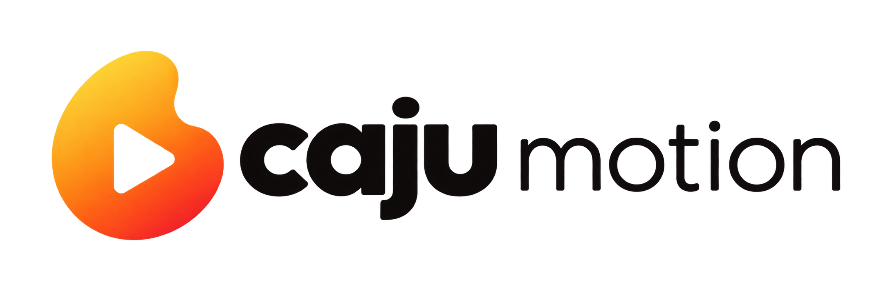

<p align="center"></p>

<p align="center"><strong>Code it. Then move it.</strong><br>
Motion graphics by code <em>and</em> by a visual timeline, on the same source of truth.</p>

---

**Caju Motion** is an open-source (MIT) video framework. One JSON document, `project.json`, describes the whole video:

- **code** generates it (a TypeScript builder today, the `@caju-motion/sdk` later),
- **Caju Studio** edits it on a multi-track timeline (move, trim, keyframes, text, colors, audio),
- the **renderer** draws it frame by frame with React. The same code serves preview and export.

Coding agents get first-class support: [`packages/skills`](packages/skills) ships Agent Skills that teach them to structure assets and audio and to generate valid projects.

> **Status: v0.2** — render to MP4/MOV/WebM/GIF (`caju render`), video by code (`video.ts` + `caju build`) and custom React components with hot reload. Not on npm yet. See the [roadmap](docs/FRAMEWORK.md#7-roadmap).

📖 **Docs:** https://mardelaraujo.github.io/caju_motion (English · Português) · for AI tools: [`llms.txt`](https://mardelaraujo.github.io/caju_motion/llms.txt)

## Quick start

> Coming with the first npm release:

```bash
npm create caju@latest my-video     # templates: blank, reel-legendado, explainer-16x9, data-video, audiograma
cd my-video && npm run dev          # Caju Studio
npx caju render <id>                # export
npx caju doctor                     # check Node, FFmpeg, browser, memory…
```

## From source

Requirements: Node ≥ 20.11.

```bash
git clone https://github.com/MardelAraujo/caju_motion.git
cd caju_motion
npm install
npm run studio                              # Caju Studio at http://localhost:3700 (projects in ./projects)
npm run caju -- new my-video --format reel-9x16
npm run caju -- check                       # validate projects (schema, assets, components, determinism)
npm run caju -- build exemplo-codigo        # projects/<id>/video.ts → project.json (keeps Studio edits)
npm run build -w @caju-motion/studio        # once, before rendering
npm run caju -- render exemplo-codigo       # → projects/exemplo-codigo/renders/*.mp4
npm run check                               # typecheck + determinism lint + tests + fixtures
```

Custom animated components live in `components/` (`defineComponent` + a zod schema of props). They show up in the Studio's **Componentes** tab and hot-reload on save.

Formats: `reel-9x16`, `feed-4x5`, `square-1x1`, `landscape-16x9`. All commands accept `--dir <projectsFolder>`.

Agents: `npm run caju -- skills add --target <your-project> --agents all` installs the skills in `.claude/skills/` and an `AGENTS.md` block.

## Packages

| Package | What it does |
|---|---|
| [`@caju-motion/schema`](packages/schema) | The `project.json` format (zod), formats with safe areas, migrations |
| [`@caju-motion/core`](packages/core) | Runtime: `useFrame`, `Sequence`, `interpolate`, `spring`, easing, keyframes, `random(seed)`, `delayRender` |
| [`@caju-motion/renderer`](packages/renderer) | Draws a project at any frame as React DOM |
| [`@caju-motion/server`](packages/server) | Local project store (atomic saves + history), assets API, production Studio server |
| [`@caju-motion/studio`](packages/studio) | Caju Studio, the visual editor (shipped prebuilt) |
| [`@caju-motion/cli`](packages/cli) | The `caju` command |
| [`@caju-motion/skills`](packages/skills) | Agent Skills for Claude Code and compatible agents |

## Generating videos with code

`scripts/examples/builder.ts` builds projects scene by scene. Every element becomes a separate clip you can edit in the Studio. A full guide lives in the [authoring skill](packages/skills/skills/caju-authoring/generator-script.md).

## Rules that keep renders correct

- Time is always in **integer frames**. Keyframe frames are relative to the clip start.
- Rendering is a **pure function of `(project, frame)`**. No `Math.random`, `Date`, timers or CSS animations in render code; `npm run lint` enforces it.
- Assets live inside the project folder and are referenced by relative paths.
- `?render=<project>&frame=<n>` shows a single frame at full size. This is the base of export.

## Development

```text
packages/   schema · core · renderer · server · studio · cli · skills
fixtures/   minimal valid projects (CI validates them)
projects/   local projects (an example is included)
scripts/    determinism lint, fixture media, the project builder
docs/       FRAMEWORK.md (plan & roadmap) · PLANO.md (original technical plan, pt-BR)
```

- Packages export their TypeScript source under the `source` condition (used by the monorepo, tests and `npm run studio`), and `dist/` for npm (`npm run build`).
- Releases: [changesets](.changeset/README.md), lockstep versions.
- Fonts that can't be redistributed can be added locally in `packages/studio/public/fonts/local/` (git-ignored).

## License

[MIT](LICENSE) © 2026 Caju

---

🇧🇷 **Em português:** o Caju Motion é um framework de vídeo por código + editor visual (Caju Studio), open source (MIT). O plano completo e o roadmap estão em [`docs/FRAMEWORK.md`](docs/FRAMEWORK.md).
