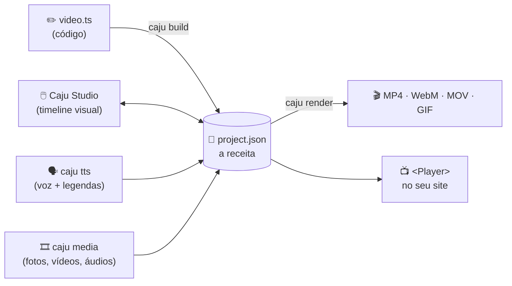

<p align="center"></p>

<p align="center"><strong>Escreva em código. Depois, mexa com as mãos.</strong><br>
Vídeos animados feitos por código <em>e</em> por uma timeline visual, sobre o mesmo arquivo.</p>

<p align="center">
  <a href="LICENSE"></a>
  
  
  <a href="https://mardelaraujo.github.io/caju_motion/pt/"></a>
</p>

<p align="center"><a href="README.md">English</a> · <b>Português</b></p>

<p align="center"></p>

---

## Sumário

1. [O que é o Caju Motion](#1-o-que-é-o-caju-motion)
2. [Situação atual: o que funciona e o que falta](#2-situação-atual-o-que-funciona-e-o-que-falta)
3. [Do que você precisa](#3-do-que-você-precisa)
4. [Instalação](#4-instalação)
5. [Seu primeiro vídeo, passo a passo](#5-seu-primeiro-vídeo-passo-a-passo)
6. [Como o Caju pensa: conceitos básicos](#6-como-o-caju-pensa-conceitos-básicos)
7. [Três jeitos de criar](#7-três-jeitos-de-criar)
8. [Locução e legendas](#8-locução-e-legendas)
9. [Configurando suas chaves de API](#9-configurando-suas-chaves-de-api)
10. [Mídia: vídeos, fotos e áudios](#10-mídia-vídeos-fotos-e-áudios)
11. [Exportando o vídeo](#11-exportando-o-vídeo)
12. [Colocando o vídeo num site (Player)](#12-colocando-o-vídeo-num-site-player)
13. [Usando com agentes de IA](#13-usando-com-agentes-de-ia)
14. [Todos os comandos](#14-todos-os-comandos)
15. [Problemas comuns](#15-problemas-comuns)
16. [O que ficou de fora (e como se virar sem)](#16-o-que-ficou-de-fora-e-como-se-virar-sem)
17. [Para quem quer contribuir](#17-para-quem-quer-contribuir)

---

## 1. O que é o Caju Motion

O Caju Motion é uma ferramenta **gratuita e de código aberto (MIT)** para fazer vídeos animados: reels, explicativos, vídeos com gráficos, podcasts com forma de onda, legendas automáticas etc.

Todo vídeo do Caju é descrito por **um único arquivo**, o `project.json`. Pense nele como uma **receita**: diz o que aparece na tela, quando aparece, como se mexe e que som toca. Essa receita pode ser escrita de dois jeitos, e os dois funcionam juntos:

| | Com código (`video.ts`) | Com as mãos (Caju Studio) |
|---|---|---|
| Para quem | quem programa, ou quem usa um agente de IA | qualquer pessoa |
| Bom para | muitos vídeos parecidos, vídeos com dados, roteiros longos | ajustes finos, posicionar, trocar cor, cortar |
| Como | TypeScript com `defineProject` + `caju build` | editor no navegador, parecido com o CapCut |

> O diferencial: você pode gerar o vídeo por código, ajustar no Studio, mudar o código e gerar de novo **sem perder o que ajustou à mão**.

Depois, o **renderizador** desenha cada quadro do vídeo (30 por segundo) num navegador escondido e junta tudo, com o som, num arquivo de vídeo (MP4, WebM, MOV, GIF…). A prévia do Studio e o vídeo final usam o mesmo código, então o que você vê é o que sai.



---

## 2. Situação atual: o que funciona e o que falta

**Versão 0.2 (ainda não publicada no npm).** Tudo abaixo funciona e é testado automaticamente no Windows e no Linux a cada mudança.

| Recurso | Situação | Comando / onde |
|---|---|---|
| Editor visual (Caju Studio) | ✅ pronto | `caju studio` |
| Vídeo por código | ✅ pronto | `video.ts` + `caju build` |
| Componentes animados em React (gráficos, contadores, tarjas) | ✅ pronto | pasta `components/` |
| Exportar MP4, MP4 HEVC, MOV ProRes, WebM, GIF, PNG | ✅ pronto | `caju render` ou botão **Exportar** |
| Locução com voz gerada (TTS) + legendas automáticas | ✅ pronto | `caju tts`, `caju captions` |
| Leitura de mídia, miniaturas, forma de onda, proxies de edição | ✅ pronto | `caju media` |
| Player para colocar o vídeo num site React | ✅ pronto | `@caju-motion/player` |
| Diagnóstico do ambiente | ✅ pronto | `caju doctor` |
| 5 modelos prontos para começar | ✅ pronto | `create-caju` |
| Skills para agentes de IA (Claude Code e outros) | ✅ pronto | `caju skills add` |
| Instalar com `npm create caju` | ⏳ **pendente**: falta publicar no npm | por enquanto, [pelo código-fonte](#41-hoje-pelo-código-fonte) |
| Render na nuvem (`@caju-motion/cloud`) | ⏸️ **adiado** | [veja como se virar](#16-o-que-ficou-de-fora-e-como-se-virar-sem) |
| Loja de modelos (marketplace) | ⏸️ **adiado** | [veja como se virar](#16-o-que-ficou-de-fora-e-como-se-virar-sem) |
| Fontes próprias como asset do projeto | ⏸️ ainda não | use as fontes embutidas ([detalhes](#fontes)) |
| Editar keyframes direto na timeline | ⏸️ ainda não | keyframes tocam, mas são escritos no código |

---

## 3. Do que você precisa

| Item | Obrigatório? | Observação |
|---|---|---|
| **Node.js 20.11 ou mais novo** (recomendado: 22 LTS) | sim | https://nodejs.org |
| **Google Chrome** ou **Microsoft Edge** | sim, para exportar | o render usa o navegador que já está instalado |
| **Git** | sim, enquanto não sair no npm | para baixar o código |
| FFmpeg | **não** | já vem embutido (`ffmpeg-static`) |
| Memória | 4 GB livres recomendados | com pouca memória, use `--concurrency 1` |
| Espaço em disco | ~1 GB livre | renders longos precisam de mais |
| Chave da OpenAI ou ElevenLabs | **não** | só para vozes reais; existe uma voz provisória grátis |

---

## 4. Instalação

### 4.1 Hoje: pelo código-fonte

Abra um terminal (PowerShell no Windows, Terminal no macOS/Linux):

```bash
# 1. baixar
git clone https://github.com/MardelAraujo/caju_motion.git
cd caju_motion

# 2. instalar as dependências (uma vez; leva 1 a 3 minutos)
npm install

# 3. compilar os pacotes e o Studio (uma vez, e de novo depois de um "git pull")
npm run build

# 4. conferir se está tudo certo
npm run caju -- doctor
```

O `doctor` deve terminar com **✓ tudo pronto** (exemplo; versões e números variam de máquina para máquina):

```text
caju doctor — diagnóstico do ambiente

✓ Node.js              v24.13.0
✓ npm                  11.6.2
✓ FFmpeg (render)      6.1.1 (ffmpeg-static)
✓ Navegador (render)   Google Chrome (C:\Program Files\Google\Chrome\Application\chrome.exe)
✓ Caju Studio          app buildado
✓ Projetos             projects: exemplo, exemplo-codigo
✓ Componentes          components: CountUp, LowerThird
✓ Espaço em disco      4.6 GB livres
✓ Memória              6.2 de 15.7 GB livres
✓ Permissão de escrita projects
✓ Voz (caju tts)       só a voz provisória (placeholder)
                       → para vozes reais, ponha OPENAI_API_KEY ou ELEVENLABS_API_KEY no .env do projeto

✓ tudo pronto
```

Se aparecer **✗** ou **!**, a linha seguinte (→) diz o que fazer. Veja também [Problemas comuns](#15-problemas-comuns).

> **Importante:** dentro do código-fonte, todo comando começa com `npm run caju --` (com os dois tracinhos).
> Exemplo: `npm run caju -- render meu-video`. Neste README, os comandos aparecem como `caju …` para ficarem curtos.

**Guardar os vídeos em outra pasta.** Por padrão os projetos ficam em `caju_motion/projects/`. Para usar outra pasta, acrescente `--dir`:

```bash
npm run caju -- studio --dir C:/Users/voce/Videos/caju
npm run caju -- new meu-video --dir C:/Users/voce/Videos/caju
```

### 4.2 Depois da publicação no npm (em breve)

Quando os pacotes forem publicados, não vai ser preciso baixar o código:

```bash
npm create caju@latest meu-video     # pergunta qual modelo usar
cd meu-video
npm run dev                          # abre o Caju Studio
```

O projeto criado já vem com `package.json`, os scripts (`dev`, `build`, `check`, `render`, `doctor`), um `.gitignore` que protege suas chaves e as instruções para agentes de IA. Os modelos são:

| Modelo | Formato | O que traz |
|---|---|---|
| `blank` | reel 9:16 | um projeto vazio com `video.ts` |
| `reel-legendado` | reel 9:16 | título, legendas por trecho e uma tarja de nome animada |
| `explainer-16x9` | 16:9 | vídeo explicativo em cenas, com contador animado |
| `data-video` | feed 4:5 | gráfico de barras animado a partir de um JSON |
| `audiograma` | quadrado 1:1 | capa de podcast com forma de onda animada |

---

## 5. Seu primeiro vídeo, passo a passo

### Passo 1: criar o projeto

```bash
caju new meu-video --format reel-9x16
```

Formatos disponíveis:

| Formato | Tamanho | Uso típico |
|---|---|---|
| `reel-9x16` | 1080 × 1920 | Reels, Stories, TikTok, Shorts |
| `feed-4x5` | 1080 × 1350 | feed do Instagram/LinkedIn |
| `square-1x1` | 1080 × 1080 | posts quadrados, podcasts |
| `landscape-16x9` | 1920 × 1080 | YouTube, apresentações |

Cada formato já vem com as **áreas seguras** marcadas (onde a interface do app não cobre o vídeo).

### Passo 2: abrir o Studio

```bash
caju studio          # no código-fonte: npm run studio
```

Abra **http://localhost:3700** no navegador.

<p align="center"></p>

| Área | Para que serve |
|---|---|
| **Esquerda** | biblioteca: Mídia (envie fotos/vídeos/áudios), Áudio, Texto, Elementos (formas) e Componentes |
| **Centro** | prévia do vídeo; clique para selecionar, arraste para mover, use as alças para girar e redimensionar |
| **Direita** | propriedades do item selecionado: texto, fonte, tamanho, cores, fundo, volume |
| **Embaixo** | timeline: cada linha é uma trilha; arraste os clipes para mudar quando aparecem e puxe as bordas para cortar |

Atalhos principais: **Espaço** toca/pausa · **S** divide no cursor · **Delete** apaga · **Ctrl+D** duplica · **Ctrl+Z / Ctrl+Shift+Z** desfaz/refaz · **←/→** anda um quadro · **Ctrl+S** salva.

O Studio salva no próprio `project.json` e guarda cada versão anterior em `projects/<id>/.caju/history/`, então dá para voltar atrás.

### Passo 3: exportar

Clique em **Exportar**, no canto superior direito:

<p align="center"></p>

Ou pelo terminal:

```bash
caju render meu-video
```

O arquivo vai para `projects/meu-video/renders/`. Pronto, esse é o seu primeiro vídeo. 🎉

---

## 6. Como o Caju pensa: conceitos básicos

Você não precisa saber isto para usar o Studio, mas ajuda muito, principalmente com código ou com agentes de IA.

- **Projeto:** uma pasta em `projects/<id>/` com o `project.json` e os arquivos usados (`assets/`).
- **Quadro (frame):** o tempo no Caju é contado em quadros inteiros. A 30 fps, 1 segundo = 30 quadros.
- **Trilha (track):** uma linha da timeline. Trilhas de cima aparecem na frente.
- **Clipe:** um item numa trilha, com início e duração: texto, forma, imagem, vídeo, áudio ou componente.
- **Keyframes:** valores que mudam com o tempo (posição, opacidade, escala, cor…), com curvas de suavização.
- **Asset:** um arquivo do projeto (foto, vídeo, áudio). Fica sempre **dentro** da pasta do projeto.

```text
meu-video/                      ← um projeto criado com npm create caju
├── package.json
├── .env                        ← suas chaves de API (ignorado pelo git)
├── components/                 ← componentes React animados (opcional)
└── projects/
    └── meu-video/
        ├── video.ts            ← a receita em código (opcional)
        ├── project.json        ← a receita (gerada pelo código e/ou editada no Studio)
        ├── assets/
        │   ├── images/  video/  data/
        │   └── audio/vo/  audio/music/  audio/sfx/
        ├── renders/            ← vídeos exportados (ignorado pelo git)
        └── .caju/              ← histórico e cache (ignorado pelo git)
```

---

## 7. Três jeitos de criar

### 7.1 No Studio (sem programar)

Arraste fotos e vídeos para a área **Mídia**, adicione **Texto** e **Elementos**, organize na timeline e exporte. É o caminho da [seção 5](#5-seu-primeiro-vídeo-passo-a-passo).

### 7.2 Com código (`video.ts`)

Crie `projects/<id>/video.ts`:

```ts
import { defineProject } from '@caju-motion/sdk';

export default defineProject({ id: 'promo', format: 'reel-9x16' }, (p) => {
  const { width, height } = p.settings;

  p.scene('abertura', 'Abertura', 0, p.sec(3), (s) => {
    s.rect(width, height, { fill: '#171512' }, { x: width / 2, y: height / 2, locked: true });
    s.text('Olá, Caju!', { size: 110, weight: 800, color: '#F6B73C' }, {
      x: width / 2,
      y: height / 2,
      enter: { at: 0, dur: 18, rise: 60 }, // entra subindo
    });
  });
});
```

Depois gere o `project.json` e confira:

```bash
caju build promo     # código → project.json
caju check promo     # valida (estrutura, arquivos, componentes)
caju studio          # abra, ajuste à mão se quiser
```

**Código e Studio convivem:** clipes criados pelo código são marcados como `code`, e os criados no Studio como `editor`. Ao rodar `caju build` de novo, só os clipes de código são refeitos e os do Studio ficam. Se você editou no Studio um clipe que veio do código, o build **avisa e não grava**; use `--force` para o código vencer.

### 7.3 Componentes React (gráficos, contadores, tarjas…)

Quando os keyframes não bastam, crie um componente em `components/`:

```tsx
import { z } from 'zod';
import { defineComponent } from '@caju-motion/renderer';
import { interpolate, useFrame } from '@caju-motion/core';

export const Contador = defineComponent({
  name: 'Contador',
  label: 'Contador animado',
  schema: z.object({
    ate: z.number().default(100),
    cor: z.string().describe('color').default('#F6B73C'),
  }),
  component: ({ ate, cor }) => {
    const valor = Math.round(interpolate(useFrame(), [0, 45], [0, ate], { extrapolateRight: 'clamp' }));
    return <div style={{ fontSize: 160, fontWeight: 800, color: cor }}>{valor}</div>;
  },
});
```

Ele aparece na aba **Componentes** do Studio. As props do `schema` viram controles (texto, número, cor), e ao salvar o arquivo o Studio recarrega sozinho:

<p align="center"></p>

> Regra de ouro: a animação depende **só do quadro** (`useFrame()`) e das props. Nada de `Math.random()`, `Date.now()`, timers ou animações CSS; o `caju check` acusa. É isso que garante que a prévia e o vídeo final fiquem iguais.

---

## 8. Locução e legendas

O `caju tts` transforma um texto em locução, anota **quando cada palavra é falada** e cria as legendas sincronizadas.

```bash
# 1. monte o vídeo com a voz provisória (grátis: um tom suave + tempos estimados)
caju tts meu-video --text "Todo vídeo começa com uma ideia. O Caju transforma código em vídeo."

# 2. com o roteiro fechado, gere a voz de verdade
caju tts meu-video --script roteiro.txt --provider openai --voice nova --language pt
caju tts meu-video --script roteiro.txt --provider elevenlabs --voice <voice_id>
```

O que ele cria no projeto:

| Arquivo | Conteúdo |
|---|---|
| `assets/audio/vo/locucao.mp3` | a locução (`--name` muda o nome) |
| `assets/data/locucao.words.json` | o roteiro e o início/fim de cada palavra |
| `assets/data/locucao.srt` | as legendas, prontas para YouTube/Instagram |

E na timeline: a locução numa trilha **Locução** e uma legenda por frase numa trilha **Legendas**, editáveis como qualquer texto.

| Provedor (`--provider`) | Custo | Tempos das palavras | Chave |
|---|---|---|---|
| `placeholder` (padrão) | grátis | estimados | nenhuma |
| `openai` | pago (sua conta) | exatos | `OPENAI_API_KEY` |
| `elevenlabs` | pago (sua conta) | exatos | `ELEVENLABS_API_KEY` |

**Você nunca paga duas vezes pela mesma fala.** Mesmo texto + mesma voz = o arquivo é reaproveitado. Mudou o texto ou a voz? Gera de novo (ou force com `--force`). Rodar de novo também **não desfaz** o que você ajustou no Studio: posição, trilha, volume e fades da locução ficam.

Outras opções: `--start 1.5` (começa em 1,5 s), `--speed 1.1`, `--no-captions`, `--name vo-01` (uma locução por cena).

**Já tem legendas prontas?** Importe um `.srt` ou `.vtt`:

```bash
caju captions meu-video --from legenda.srt
```

**No código:** num projeto com `video.ts`, o `caju tts` só cria os arquivos (não mexe no `project.json`), e você usa as legendas assim:

```ts
import { fileURLToPath } from 'node:url';
import { readCaptions } from '@caju-motion/voice';

const cues = await readCaptions(fileURLToPath(new URL('./assets/data/locucao.words.json', import.meta.url)));
s.captions(cues, { size: 54, weight: 800, color: '#FFFFFF', bg: '#000000B3' }, { x: 540, y: 1500 });
```

Guia completo: [Locução e legendas](https://mardelaraujo.github.io/caju_motion/pt/guide/voice-captions).

---

## 9. Configurando suas chaves de API

As chaves só são necessárias para **vozes reais** (`caju tts --provider openai|elevenlabs`). Todo o resto funciona sem chave.

### Onde conseguir

| Provedor | Onde criar a chave | Variável |
|---|---|---|
| OpenAI | https://platform.openai.com/api-keys | `OPENAI_API_KEY` |
| ElevenLabs | https://elevenlabs.io/app/settings/api-keys | `ELEVENLABS_API_KEY` |

### Jeito recomendado: arquivo `.env`

Crie um arquivo chamado **`.env`** na pasta onde você roda os comandos (a raiz do seu projeto, ou a pasta `caju_motion` se estiver usando o código-fonte):

```dotenv
# .env: suas chaves; NUNCA envie este arquivo para o GitHub
OPENAI_API_KEY=sk-proj-xxxxxxxxxxxxxxxxxxxxxxxx
ELEVENLABS_API_KEY=xxxxxxxxxxxxxxxxxxxxxxxx
```

O Caju lê esse arquivo sozinho a cada comando. Depois, confira:

```bash
caju doctor
# ✓ Voz (caju tts)       placeholder + openai, elevenlabs
```

O `doctor` mostra **quais** provedores estão configurados, nunca a chave.

> 🔒 **Segurança**
> - Projetos criados pelo `create-caju` já vêm com `.env` no `.gitignore`, assim como o repositório do Caju.
> - Quer compartilhar o formato com a equipe? Crie um `.env.example` com os nomes e **valores vazios**; esse pode ir para o git.
> - Se uma chave vazar, apague-a no painel do provedor e crie outra.
> - Defina um limite de gastos no painel da OpenAI/ElevenLabs.

### Alternativa: variável no terminal

Uma variável definida no terminal **tem prioridade** sobre o `.env`.

<details>
<summary><b>Windows (PowerShell)</b></summary>

```powershell
# só nesta janela do terminal
$env:OPENAI_API_KEY = "sk-proj-..."

# permanente para o seu usuário (feche e abra o terminal depois)
setx OPENAI_API_KEY "sk-proj-..."
```
</details>

<details>
<summary><b>macOS / Linux (bash, zsh)</b></summary>

```bash
# só nesta sessão
export OPENAI_API_KEY="sk-proj-..."

# permanente: acrescente a linha acima ao ~/.zshrc (macOS) ou ~/.bashrc (Linux)
echo 'export OPENAI_API_KEY="sk-proj-..."' >> ~/.zshrc
```
</details>

---

## 10. Mídia: vídeos, fotos e áudios

Envie arquivos pelo botão **Carregar** do Studio ou copie-os para `projects/<id>/assets/`. Depois rode:

```bash
caju media meu-video                  # lê duração, tamanho, fps e áudio de tudo
caju media meu-video --proxies auto   # + cópias leves dos vídeos pesados (4K, HEVC)
```

- Preenche os dados de cada arquivo no `project.json` (sem você medir nada).
- Gera **miniaturas** e **formas de onda** que o Studio usa direto.
- Com `--proxies`, cria **cópias leves** (540p) que o Studio toca durante a edição, para vídeos 4K de celular não travarem a timeline. **O vídeo exportado sempre usa o arquivo original.**
- `--dry-run` só mostra o que mudaria.

Formatos aceitos: imagens (PNG, JPG, WebP, SVG, GIF), vídeo (MP4 H.264 é o mais seguro; MOV, WebM, MKV também) e áudio (WAV, MP3, M4A, AAC, OGG, FLAC).

> Dica: vídeos de celular costumam ter **taxa de quadros variável**, o que atrapalha a precisão. Converta antes de usar; a receita está no [guia de assets](https://mardelaraujo.github.io/caju_motion/pt/guide/assets).

<a id="fontes"></a>**Fontes:** hoje o Studio traz **Plus Jakarta Sans** e **Red Hat Display**. Fontes próprias como asset do projeto ainda não existem. Quem trabalha no código-fonte pode instalar fontes localmente em `packages/studio/public/fonts/local/` (pasta ignorada pelo git, para não redistribuir fontes sem licença).

---

## 11. Exportando o vídeo

```bash
caju render meu-video                                   # MP4 1080p, qualidade alta
caju render meu-video --format webm-vp9 --resolution 720
caju render meu-video --out final.mp4 --quality max
caju still meu-video --frame 45 --out capa.png          # um quadro como imagem
```

| Opção | Valores | Padrão |
|---|---|---|
| `--format` | `mp4-h264`, `mp4-h265`, `mov-prores`, `webm-vp9`, `gif`, `png-seq` | `mp4-h264` |
| `--resolution` | `720`, `1080`, `1440`, `2160` | tamanho do projeto |
| `--fps` | `24`, `25`, `30`, `50`, `60` | o do projeto |
| `--quality` | `draft`, `good`, `high`, `max` | `high` |
| `--no-audio` | sem som | com som |
| `--concurrency` | abas do navegador em paralelo (`1`–`2`) | automático |
| `--out` | arquivo de saída | `projects/<id>/renders/<id>-<data>.<ext>` |

Como funciona por dentro: o Caju abre o Chrome/Edge sem janela, desenha cada quadro, tira uma "foto" e manda para o FFmpeg; o áudio é mixado à parte (volume, fades, cortes, velocidade) e juntado no fim, com sincronia testada (≤ 1 quadro de diferença).

---

## 12. Colocando o vídeo num site (Player)

Para mostrar um vídeo do Caju dentro de um app React, sem exportar:

```bash
npm install @caju-motion/player react react-dom
```

```tsx
import { Player } from '@caju-motion/player';
import projeto from './projects/meu-video/project.json';

export function Destaque() {
  return <Player project={projeto} assetBase="/videos/meu-video/" controls loop autoPlay initiallyMuted />;
}
```

Copie a pasta `assets/` do projeto para os arquivos públicos do site (ex.: `public/videos/meu-video/assets/`). O player tem controles, teclado (espaço, setas), velocidade, trecho (`inFrame`/`outFrame`) e comandos via `ref` (`play`, `pause`, `seekTo`…). Referência: [`@caju-motion/player`](https://mardelaraujo.github.io/caju_motion/pt/reference/player).

---

## 13. Usando com agentes de IA

O Caju traz **skills**: manuais que ensinam agentes como o Claude Code a criar vídeos válidos, organizar assets, sincronizar com a locução e exportar.

```bash
caju skills add --agents all     # instala em .claude/skills/ e adiciona um bloco no AGENTS.md
```

Depois é só pedir, por exemplo: *"crie um reel de 15 segundos sobre o lançamento do produto X, com legendas e locução provisória"*. A documentação também tem uma versão para IAs: [`llms.txt`](https://mardelaraujo.github.io/caju_motion/llms.txt).

---

## 14. Todos os comandos

> No código-fonte, use `npm run caju -- <comando>`. Todos aceitam `--dir <pasta dos projetos>`.

| Comando | O que faz |
|---|---|
| `caju studio [--port 3700] [--open]` | abre o Caju Studio |
| `caju new <id> --format reel-9x16` | cria um projeto vazio |
| `caju build [ids…] [--force] [--dry-run]` | gera o `project.json` a partir do `video.ts`, preservando edições do Studio |
| `caju check [ids…]` | valida projetos: estrutura, arquivos, componentes, determinismo |
| `caju media [ids…] [--proxies auto\|all]` | lê a mídia e gera miniaturas, formas de onda e proxies |
| `caju tts <id> --text "…"` | gera locução + legendas ([detalhes](#8-locução-e-legendas)) |
| `caju captions <id> --from arquivo.srt` | importa legendas SRT/VTT |
| `caju render <id>` | exporta o vídeo ([opções](#11-exportando-o-vídeo)) |
| `caju still <id> --frame N` | exporta um quadro como PNG |
| `caju doctor` | diagnostica o ambiente |
| `caju skills add` | instala as skills para agentes de IA |

---

## 15. Problemas comuns

Comece sempre pelo **`caju doctor`**: ele aponta a causa e o que fazer.

| Sintoma | Causa provável | Solução |
|---|---|---|
| `Navegador (render)` com ✗ | Chrome/Edge não encontrado | instale o Chrome, ou aponte `CAJU_BROWSER_PATH` para o executável |
| `Caju Studio` com ✗ ("não buildado") | faltou compilar | `npm run build` (no código-fonte) |
| Porta 3700 ocupada | outro Studio aberto | feche o outro ou use `--port 3701` |
| Render trava ou fecha sozinho | pouca memória | feche programas e use `--concurrency 1` |
| `caju tts` diz "defina OPENAI_API_KEY" | chave não configurada | [seção 9](#9-configurando-suas-chaves-de-api) |
| `HTTP 401` no TTS | chave inválida ou apagada | gere outra no painel do provedor |
| `HTTP 429` no TTS | limite ou créditos esgotados | confira o saldo no painel do provedor |
| Vídeo de celular "pula" no export | taxa de quadros variável | converta para fps constante ([guia](https://mardelaraujo.github.io/caju_motion/pt/guide/assets)) |
| Studio salvou e o `caju build` reclama de conflito | um clipe de código foi editado à mão | aceite as edições no código ou rode `caju build --force` |

Variáveis de ambiente úteis: `CAJU_BROWSER_PATH` (navegador do render), `CAJU_FFMPEG_PATH` (outro FFmpeg), `OPENAI_API_KEY`, `ELEVENLABS_API_KEY`.

---

## 16. O que ficou de fora (e como se virar sem)

Três partes do plano ainda não existem. Nenhuma impede o uso do Caju.

### ☁️ Render na nuvem (`@caju-motion/cloud`): adiado

**O que seria:** exportar vídeos em servidores, em paralelo, com fila e armazenamento, sem usar o seu computador. Seria a parte paga (licença comercial) do Caju, e foi adiada até o modelo de negócio estar definido.

**Hoje:** todo render roda **no seu computador**, com `caju render` ou o botão **Exportar**.

**Como se virar:**
- Para vídeos curtos (reels, até alguns minutos), o render local é rápido: ~15 s para um reel de 3 s em 1080p num notebook comum.
- Teste com `--quality draft --resolution 720` e deixe o `high`/`1080` para a versão final.
- Muitos vídeos? Rode um `caju render` por projeto num script, ou num servidor seu (o Caju roda em Linux sem tela, como no CI).

### 🛒 Loja de modelos (marketplace): adiada

**O que seria:** uma galeria para encontrar, baixar e vender modelos de vídeo.

**Hoje:** existem os **5 modelos** do `create-caju` ([lista](#42-depois-da-publicação-no-npm-em-breve)).

**Como se virar:**
- Um modelo do Caju é só uma **pasta**: `projects/<id>/` (com `video.ts` e `assets/`) + os `components/` que ela usa. Para compartilhar, copie a pasta ou ponha num repositório git.
- Para reaproveitar um vídeo como base, duplique a pasta do projeto, troque o `id` no `project.json` (ou no `video.ts`) e edite.

### 📦 Publicação no npm: pendente

**Hoje:** `npm create caju` e `npx caju` ainda **não funcionam**, porque os pacotes não foram publicados. Use a [instalação pelo código-fonte](#41-hoje-pelo-código-fonte). Os pacotes já estão prontos e são testados a cada mudança instalando a partir do pacote exatamente como iria para o npm; falta só a publicação.

---

## 17. Para quem quer contribuir

```bash
npm install
npm run check          # typecheck + lint de determinismo + testes + fixtures + docs
npm run studio         # Studio em modo de desenvolvimento (recarga a quente)
npm run docs:dev       # site de documentação
```

| Pacote | Função |
|---|---|
| [`@caju-motion/schema`](packages/schema) | formato do `project.json`, formatos, migrações |
| [`@caju-motion/core`](packages/core) | animação: `useFrame`, `Sequence`, `interpolate`, `spring`, easing |
| [`@caju-motion/renderer`](packages/renderer) | desenha um quadro do projeto com React; `defineComponent` |
| [`@caju-motion/player`](packages/player) | `<Player>` para apps React |
| [`@caju-motion/sdk`](packages/sdk) | `defineProject`, `caju build` com merge |
| [`@caju-motion/media`](packages/media) | leitura de mídia, miniaturas, formas de onda, proxies, decodificação exata (WebCodecs) |
| [`@caju-motion/voice`](packages/voice) | TTS (OpenAI, ElevenLabs), tempos por palavra, legendas |
| [`@caju-motion/audio`](packages/audio) | mixagem de áudio do export |
| [`@caju-motion/renderer-node`](packages/renderer-node) | render: navegador headless → FFmpeg |
| [`@caju-motion/server`](packages/server) | servidor local do Studio |
| [`@caju-motion/studio`](packages/studio) | o editor |
| [`@caju-motion/cli`](packages/cli) | o comando `caju` |
| [`@caju-motion/skills`](packages/skills) | skills para agentes de IA |
| `caju`, `create-caju` | atalho da CLI e criador de projetos |

Testes de render e de navegador (precisam do Chrome): `CAJU_RENDER_IT=1 npx vitest run packages/renderer-node packages/player packages/media --maxWorkers=1`.

Plano e roadmap: [`docs/FRAMEWORK.md`](docs/FRAMEWORK.md) · Documentação completa: https://mardelaraujo.github.io/caju_motion/pt/

## Licença

[MIT](LICENSE) © 2026 Caju. Use, modifique e distribua à vontade, inclusive comercialmente.
